<picture>
  <source media="(prefers-color-scheme: light)" srcset="./assets/logo-dark.svg">
  
</picture>

<h1 align="center">WallpaperTONS</h1>

<b>Desktop Environment &amp; Taskbar Utility</b>
 
<i>An open-source C#/WPF utility for rendering dynamic backgrounds and managing taskbar visual states.</i>

  

  

<a href="#features">Features</a> &nbsp;·&nbsp; <a href="#requirements">Requirements</a> &nbsp;·&nbsp; <a href="#quick-start">Quick Start</a> &nbsp;·&nbsp; <a href="#screenshots">Screenshots</a>

  

 

> **Overview:** WallpaperTONS is an open-source utility that relies on Microsoft Edge WebView2 to parse and render local media files as desktop backgrounds. It also interfaces with the Windows Desktop Window Manager (DWM) to configure taskbar transparency and blur effects.

## Features

<table>
<tr>
<td width="50%" valign="top"> <b>Taskbar Customization</b> Interfaces with Windows DWM to apply visual states (Acrylic, Blur, or Transparency) to the system taskbar.</td>
<td width="50%" valign="top"> <b>WebView2 Integration</b> Uses the Edge WebView2 runtime to render local video files and JSON-based configurations efficiently.</td>
</tr>
<tr>
<td width="50%" valign="top"> <b>Local Media Support</b> Manages and renders standard high-resolution images and video files stored locally on the user's machine.</td>
<td width="50%" valign="top"> <b>Offline Operation</b> Functions entirely offline with localized file management, requiring no network telemetry.</td>
</tr>
</table>

## Requirements

| Specification | Minimum Requirement |
| :--- | :--- |
| **Operating System** | Windows 10 (Build 19041+) or Windows 11 |
| **Architecture** | x64 |
| **Memory** | 2 GB RAM |
| **Graphics** | DirectX 12 Compatible GPU |
| **Dependencies** | Microsoft Edge WebView2 Runtime |

## Quick Start

1. Navigate to the **[Releases](https://github.com/Project-Tons/WallpaperTONS-App/releases/latest)** section to download the latest compiled executable.
2. Extract the archive to a local directory.
3. Execute the binary to initialize the application.
4. Configure media sources and taskbar states via the provided local interface.

## Screenshots

 <b>WallpaperTONS Core Interface</b>

 

<table>
<tr><td width="50%" align="center"> <b>Local Media Discovery</b></td><td width="50%" align="center"> <b>Engine Rendering Output</b></td></tr>
<tr><td width="50%" align="center"> <b>Vault Management</b></td><td width="50%" align="center"> <b>Taskbar Settings</b></td></tr>
</table>

 

WallpaperTONS &nbsp;·&nbsp; Project-Tons

